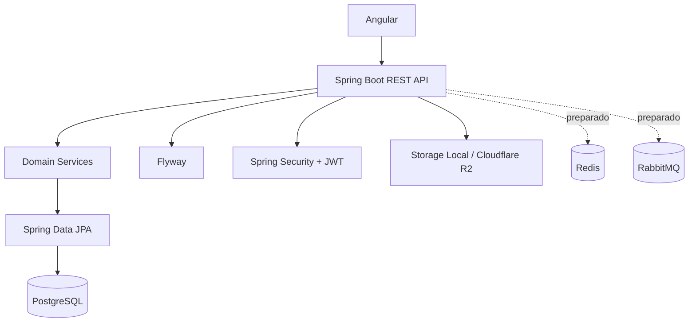
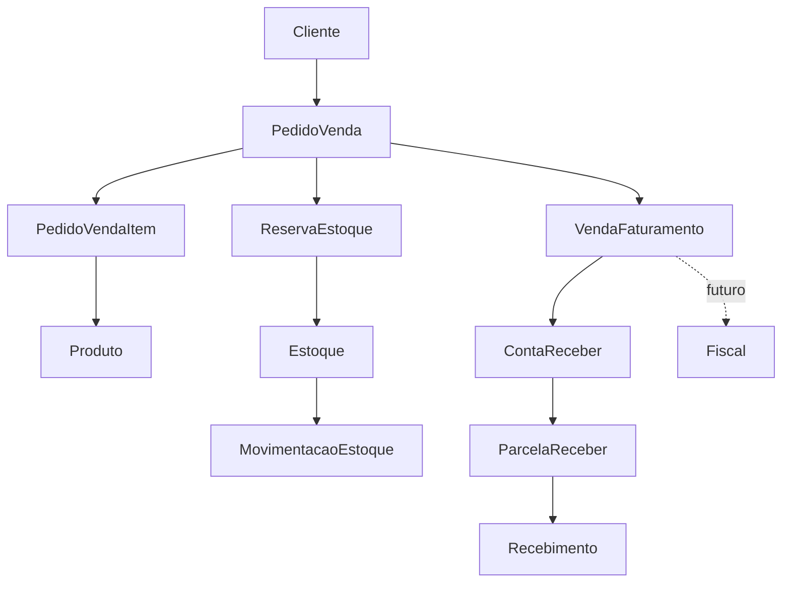
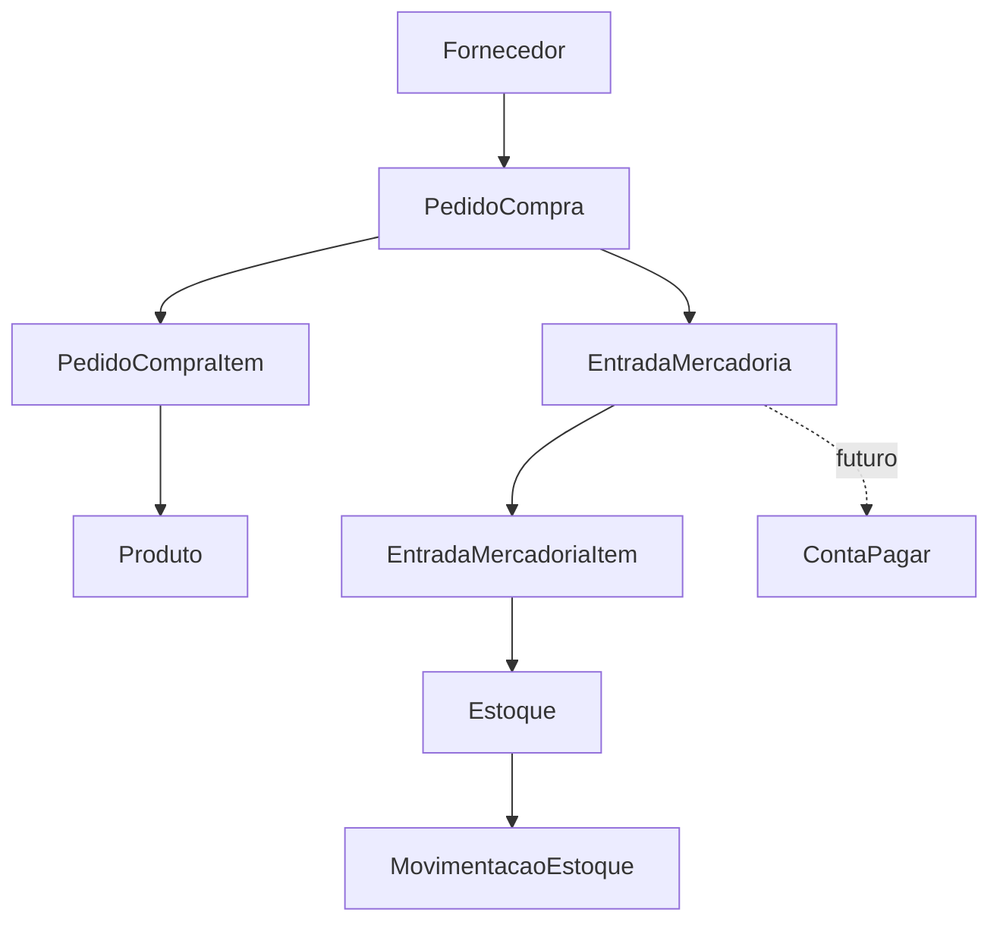
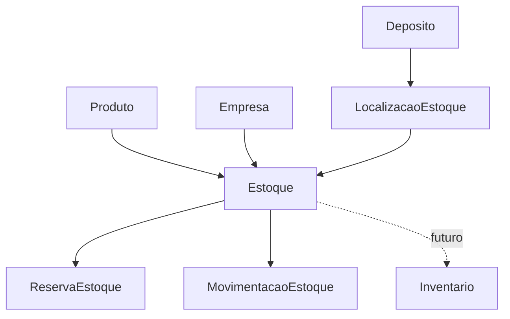
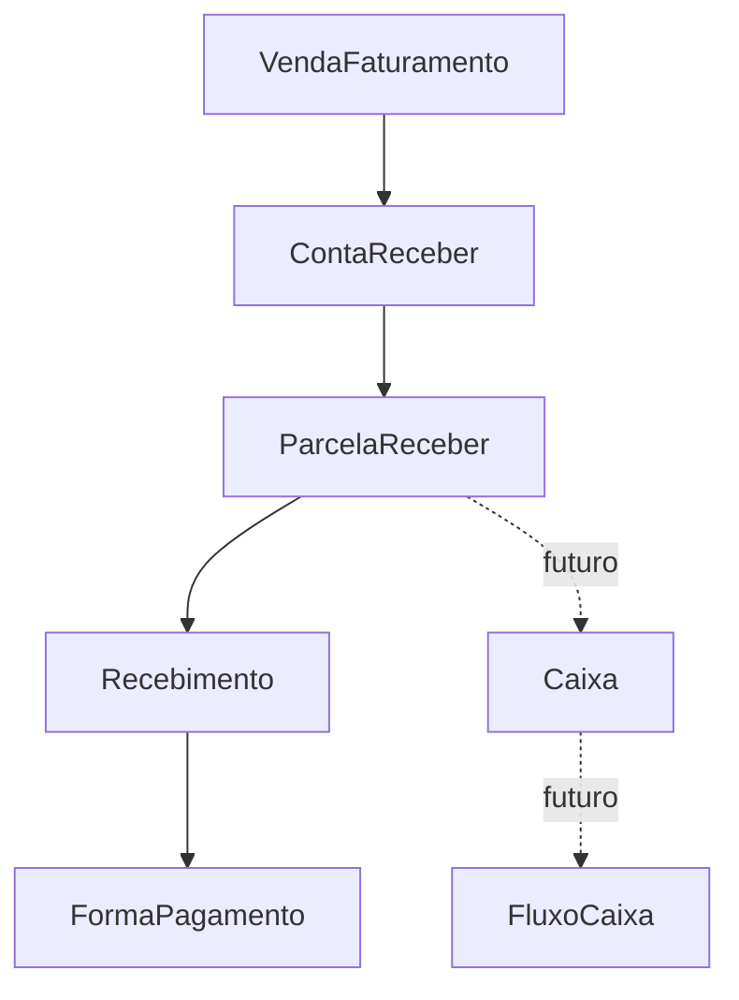
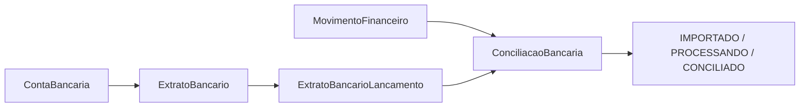
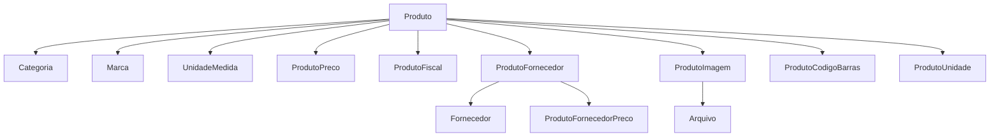

# Diagramas Mermaid

Os diagramas abaixo renderizam diretamente no GitHub.

## Diagrama Geral

## Fluxo de Venda

## Fluxo de Compra

## Fluxo de Estoque

## Fluxo Financeiro

## Conciliação Bancária

## Produto

