# Diagramas Mermaid

Os diagramas abaixo renderizam diretamente no GitHub.

## Diagrama Geral

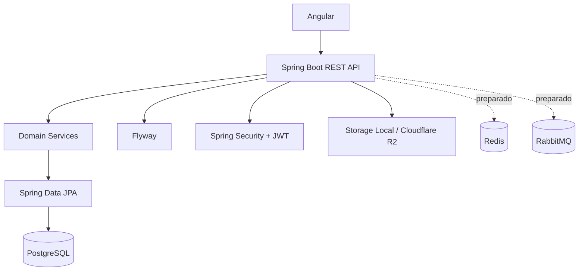

## Fluxo de Venda

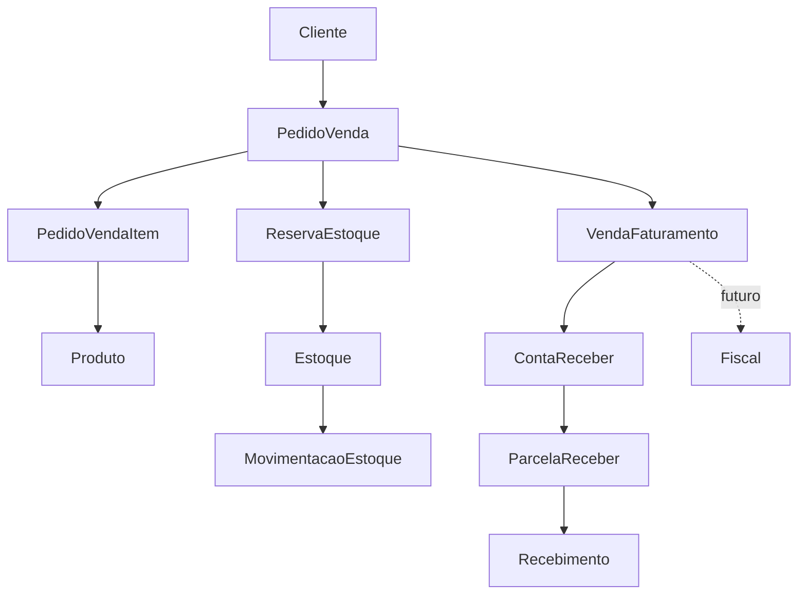

## Fluxo de Compra

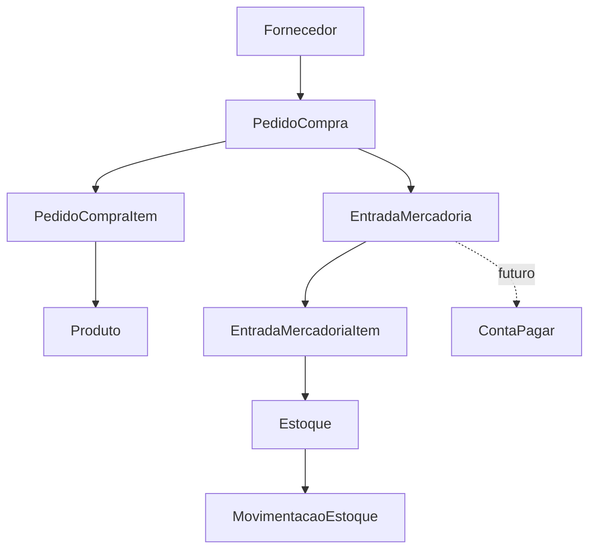

## Fluxo de Estoque

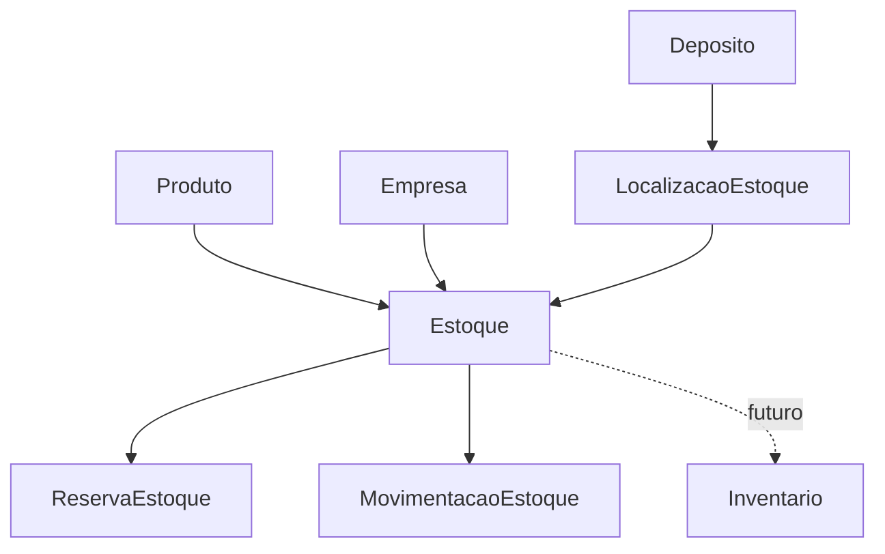

## Fluxo Financeiro

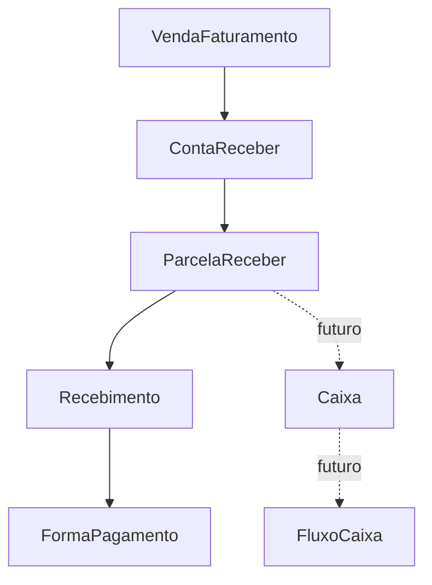

## Conciliação Bancária

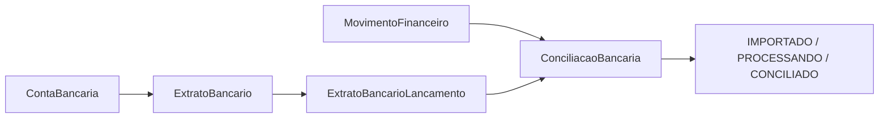

## Importação OFX

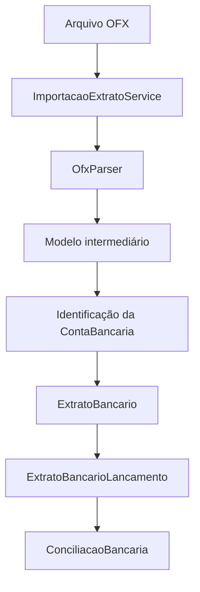

## Produto

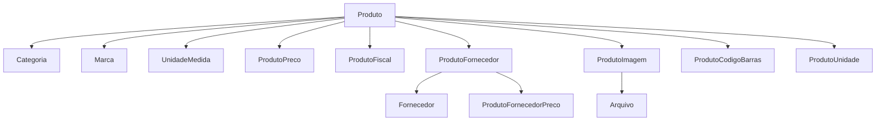

## Sugestao de conciliacao

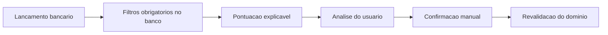

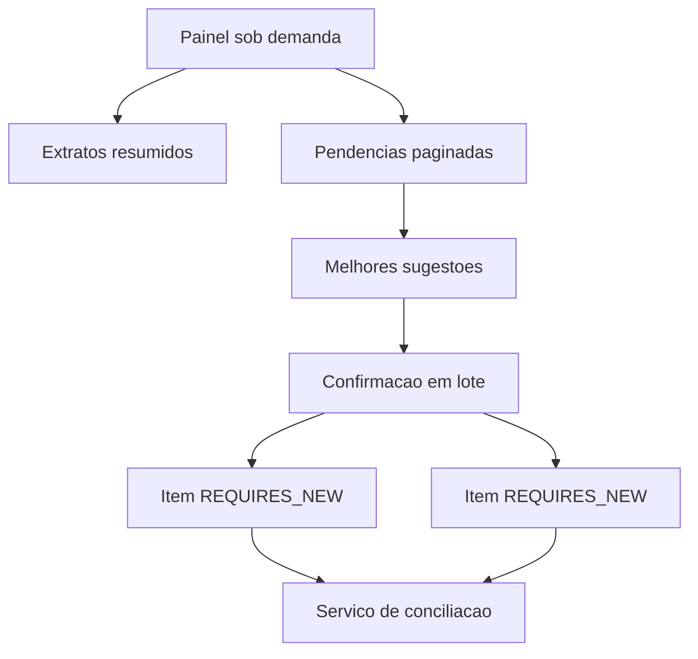

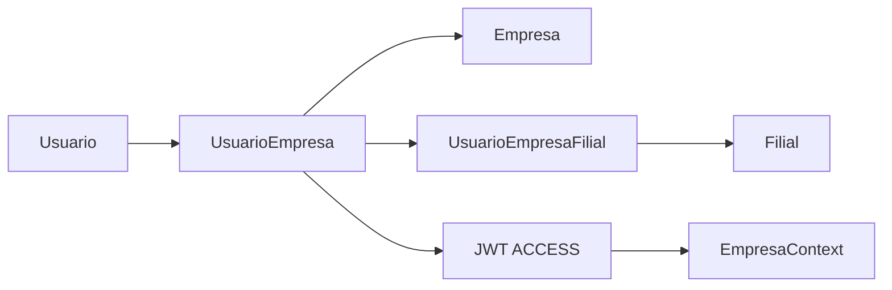
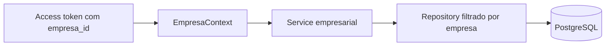

No fluxo de Estoque, `EmpresaContext` antecede as consultas de deposito, localizacao,
saldo, movimentacao e reserva. Compras e Vendas continuam consumindo `EstoqueFacade`,
sem escolher a empresa da operacao.

No fluxo de Vendas, o contexto acompanha PedidoVenda -> ReservaEstoque -> VendaFaturamento
-> ContaReceber. A troca de empresa altera todas as consultas sem receber `empresaId`.
